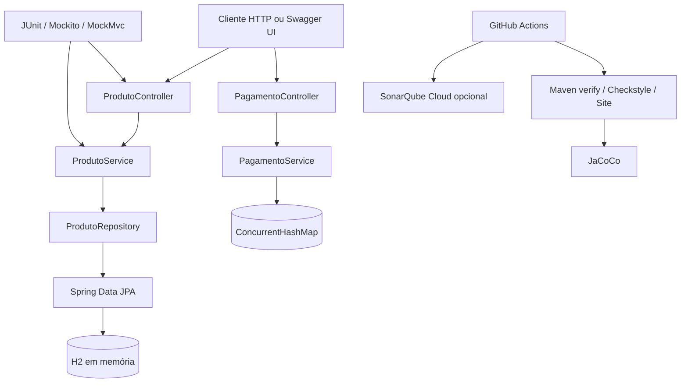

# Arquitetura do Projeto Final IQS

## Visão geral

Monólito modular Spring Boot com dois domínios: **Produtos**, com persistência em H2, e **Pagamentos**, mantido do exercício de documentação da Aula 12, com armazenamento em memória.

## Organização do código

| Caminho | Responsabilidade |
|---|---|
| `produtos/Produto.java` | Entidade JPA, validação de invariantes e formatação defensiva do preço |
| `produtos/ProdutoRepository.java` | Operações de persistência e query method da US-001 |
| `produtos/ProdutoService.java` | Regras de aplicação, transações e tratamento de recurso ausente |
| `produtos/ProdutoController.java` | Contratos REST e anotações OpenAPI |
| `produtos/ProdutoRequest.java` | Entrada validada de produtos |
| `produtos/ProdutoResponse.java` | Resposta desacoplada da entidade JPA |
| `pagamentos/` | API anterior da Aula 12, preservada |
| `src/test/java/` | Testes unitários, integração H2 e Testcontainers opcional |
| `.github/workflows/ci.yml` | Verificações automatizadas de qualidade |

## Decisões técnicas

| Decisão | Motivação | Limite |
|---|---|---|
| Monólito Spring Boot | MVP simples e coerente com a Aula 13 | Não visa escala distribuída |
| H2 em memória | Execução local sem instalação de banco | Dados são perdidos ao encerrar a aplicação |
| PostgreSQL via Testcontainers no perfil `postgres-it` | Permite integração opcional com banco real | Exige Docker e conectividade com o registry |
| Spring Data JPA | CRUD e query method sem SQL manual | Dependência de JPA/Hibernate |
| DTOs com `record` | Contratos HTTP independentes das entidades | Exige mapeamento explícito |
| Validação em duas camadas | Erros HTTP 400 e invariantes do domínio | Não substitui autenticação ou regras de autorização |
| Mockito e MockMvc | Testes isolados e de integração | Cobertura não garante ausência de falhas |
| JaCoCo + Checkstyle + SonarQube Cloud | Cobertura, estilo e análise estática | Resultados de qualidade dependem de execução real |

## Padrão de qualidade

O pipeline executa `mvn clean verify`, `mvn checkstyle:check`, `mvn site` e, quando configurado, SonarQube Cloud. O JaCoCo publica `target/site/jacoco/index.html`; os relatórios de testes são produzidos pelos plugins Surefire e Failsafe. A revisão de código ocorre por Pull Request associado a uma User Story.

## Documentação de API

Swagger UI: `http://localhost:8080/swagger-ui.html`. O esquema OpenAPI é gerado dinamicamente em `/v3/api-docs`. A documentação Javadoc da classe `Financeira` permanece disponível como demonstração do conteúdo da Aula 12.
