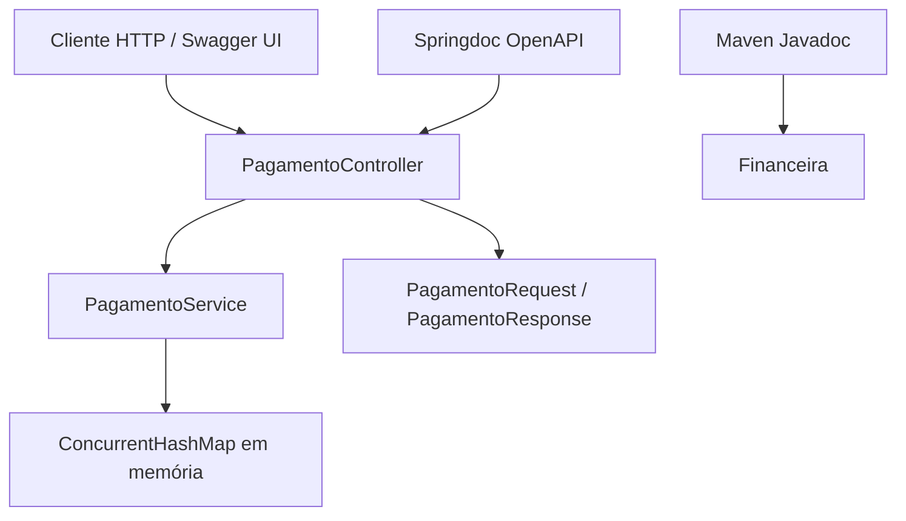

# Arquitetura — Aula 12 de IQS

## Visão geral

Aplicação Spring Boot com documentação Javadoc, Swagger/OpenAPI e Maven Site. Os pagamentos são mantidos em memória para que a execução local não exija banco de dados.

## Diagrama de componentes

## Decisões técnicas

| Decisão | Justificativa | Limitação |
|---|---|---|
| Java 17 e Spring Boot 3 | Plataforma compatível com Maven e API REST | Exige JDK 17 ou superior |
| Springdoc OpenAPI 2.x | Gera documentação HTTP automaticamente a partir de anotações | A UI depende da aplicação em execução |
| Records para requisição e resposta | Contratos de entrada e saída concisos | Validação deve ser declarada nos campos |
| Service separado do controller | Responsabilidades isoladas e testáveis | Adiciona pequena camada ao projeto |
| ConcurrentHashMap | Execução local sem infraestrutura | Dados desaparecem ao reiniciar; não é banco de produção |
| Javadoc para Financeira | Documenta contrato, argumentos, erros e exemplo | Exige atualização quando o contrato mudar |
| Maven Site | Centraliza a publicação de relatórios técnicos | Resultado é um site HTML local |

## Fluxos HTTP

1. `POST /pagamentos` valida o JSON, cria um pagamento e responde com HTTP 201 e cabeçalho `Location`.
2. `GET /pagamentos/{id}` consulta o identificador e retorna HTTP 200 ou HTTP 404.

## Restrições

O protótipo não oferece autenticação nem persistência. Não deve ser publicado como serviço financeiro em produção.
